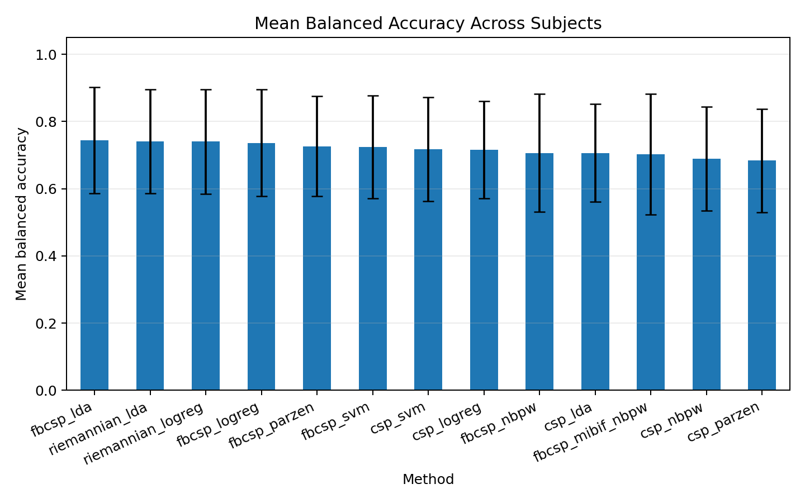

# BCI Competition IV Dataset 2b Motor Imagery Benchmark

This repository contains a compact benchmark for classical motor-imagery EEG
decoders on **BCI Competition IV Dataset 2b (Graz B)**.

The benchmark compares CSP, FBCSP, Riemannian tangent-space classifiers, SVM,
logistic regression, and competition-inspired Parzen-window classifiers under
two settings:

- `left_right_debug`: cue-based left-hand vs right-hand motor imagery.
- `rest_active_pseudo`: pseudo REST vs ACTIVE, where left/right MI trials are
  pooled as ACTIVE and safe baseline/idling windows are used as REST.

The project was created as a public-data validation step for a dissertation on
hybrid gaze + motor-imagery BCI robot control.

## What Is Included

```text
scripts/benchmark_bci2b_decoders.py
src/bci/features.py
src/bci/decoders.py
results/
docs/Classification.md
```

The benchmark script trains on sessions `01T` and `02T`, tests on session
`03T`, and writes:
## Benchmark Protocol

- Dataset: BCI Competition IV Dataset 2b
- Subjects: B01–B09
- Channels: C3, Cz, C4
- Train sessions: 01T, 02T
- Test session: 03T
- Task 1: left-hand vs right-hand motor imagery
- Task 2: pseudo REST vs ACTIVE
- Metrics: balanced accuracy, ROC-AUC, confusion matrix, class error rates
- raw benchmark CSV files,
- method summary tables,
- best-method-by-subject tables,
- PNG plots.

## What Is Not Included

The raw `.gdf` dataset files are not included in this repository.

Download BCI Competition IV Dataset 2b separately and place the files in:

```text
BCICIV_2b_gdf/
```

Official links:

- [BCI Competition IV homepage](https://www.bbci.de/competition/iv/)
- [BCI Competition IV download area](https://www.bbci.de/competition/iv/download/)
- [Dataset 2b description PDF](https://www.bbci.de/competition/iv/desc_2b.pdf)

Expected filenames:

```text
B0101T.gdf ... B0903T.gdf
```

Evaluation files `04E` and `05E` are not required for this benchmark because
the script uses labeled training sessions only.

## Installation

Create a virtual environment and install dependencies:

```powershell
python -m venv .venv
.\.venv\Scripts\Activate.ps1
python -m pip install --upgrade pip
pip install -r requirements.txt
```

## Run The Benchmark

Left-vs-right motor imagery:

```powershell
python scripts/benchmark_bci2b_decoders.py --subject all --mode left_right_debug --save-csv results/bci2b_all_left_right.csv
```

Pseudo REST-vs-ACTIVE:

```powershell
python scripts/benchmark_bci2b_decoders.py --subject all --mode rest_active_pseudo --save-csv results/bci2b_all_rest_active.csv
```

Run one subject:

```powershell
python scripts/benchmark_bci2b_decoders.py --subject 04 --mode left_right_debug --save-csv results/bci2b_s04_left_right.csv
```

## Implemented Methods

The current benchmark includes:

```text
csp_lda
csp_svm
csp_logreg
csp_parzen
csp_nbpw
fbcsp_lda
fbcsp_svm
fbcsp_logreg
fbcsp_parzen
fbcsp_nbpw
fbcsp_mibif_nbpw
riemannian_lda
riemannian_logreg
```

The most competition-inspired candidate is:

```text
fbcsp_mibif_nbpw
```

It approximates the winning Dataset 2b family:

```text
Filter Bank CSP + feature selection + Naive Bayes Parzen Window classifier
```

## Current Findings

In the current benchmark results, `FBCSP + LDA` is the strongest general
default. Riemannian models are close alternatives, and NBPW-style classifiers
can help some subjects but did not improve the mean performance in this local
benchmark.

The pseudo REST-vs-ACTIVE setting should be interpreted carefully. It uses
artificial REST labels extracted from baseline/idling windows and is not a
replacement for a true REST-vs-ACTIVE calibration protocol.

Example benchmark figure:



## Metrics

The script reports:

- balanced accuracy,
- ROC-AUC,
- confusion matrix entries,
- class-0-to-class-1 error rate,
- class-1-to-class-0 error rate.

For `left_right_debug`:

```text
class 0 = LEFT
class 1 = RIGHT
```

For `rest_active_pseudo`:

```text
class 0 = REST
class 1 = ACTIVE
```

In REST-vs-ACTIVE mode, the most safety-relevant error is:

```text
class 0 -> class 1
```

That means the model predicted ACTIVE during REST, which would be a false
positive in an online BCI control system.

## Important Limitations

This is not a full reimplementation of the official 2008 competition scoring.

Known limitations:

- epoch-level balanced accuracy and ROC-AUC are used instead of the official
  continuous sample-wise kappa evaluation;
- no full EOG regression/correction pipeline is implemented;
- evaluation sessions without public labels are not used;
- pseudo REST labels are approximate;
- hyperparameters are intentionally simple and transparent.

## Citation

Any publication using this benchmark should cite the original BCI Competition
IV Dataset 2b / Graz B data description and related competition material.

The original Dataset 2b top-ranked method used FBCSP with a Naive Bayes Parzen
Window classifier. This repository includes an approximate, compact
benchmarking version of that classifier family.

This repository also includes a `CITATION.cff` file for software citation.

## License

The benchmark code in this repository is released under the MIT License. The
BCI Competition IV Dataset 2b data files are not redistributed here and remain
subject to the original data source terms.
